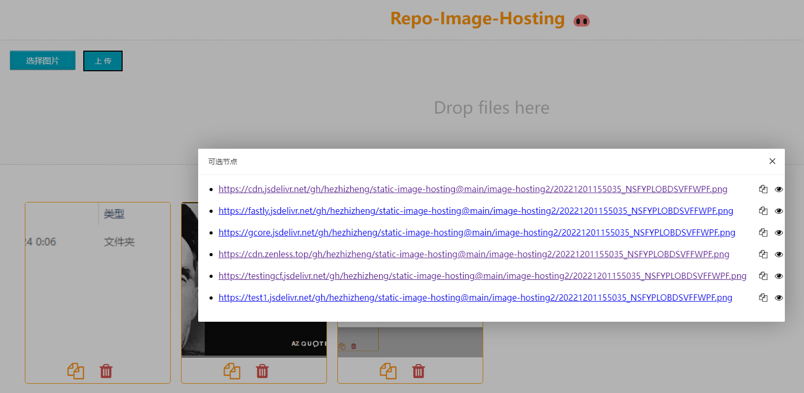

# repo-image-hosting 🐽

> Github 图床工具 (基于 Golang(Gin) 实现) [github地址](https://github.com/hezhizheng/repo-image-hosting)

```
利用 Github 做图床（Github使用jsdelivr加速）
还是用git仓库当图床算了，不然哪里有国内访问又快又免费又稳的图床服务提供......
```

> PHP composer 包：[repo-storage](https://github.com/hezhizheng/repo-storage)

## 页面


## 注意！！！
coding 、gitee 由于众所周知的原因这里不推荐使用且已不再维护，请优先使用 github 作为图床工具，已收集多个在大陆地区可访问节点，感谢 [jsdelivr-auto-fallback](https://github.com/PipecraftNet/jsdelivr-auto-fallback)


 
## 功能
- 支持使用 Github 作为图床工具
- github 使用 jsdelivr 加速
- 支持使用指定分支(必须是仓库已存在的分支)
- 一键启动，跨平台支持，运行只依赖编译后的二进制文件
- 可视化web操作界面(PS: 页面有点丑，不影响操作......)
- 多图上传，不限制图片类型
- 复制图片url 、删除图片

## 使用
用户可直接下载 [releases](https://github.com/hezhizheng/repo-image-hosting/releases) 文件启动即可，参数说明：（PS：尽量使用最新发布版本）

```
Usage of ./repo-image-hosting_windows_amd64.exe:
  -branch string               
        分支 (default "master")
  -depotid string              
        coding 仓库ID          
  -owner string
        仓库所属空间地址(企业、组织或个人的地址path) (default "hezhizheng")
  -path string
        文件的路径 (default "image-hosting")
  -platform string
        平台名称，支持gitee/github/coding (default "github")
  -port string
        本地监听的端口 (default "2047")
  -project string
        coding 项目名称
  -repo string
        仓库路径(path) (default "static-image-hosting")
  -token string
        Gitee/Github/Coding 的用户授权码

```

```
完整启动命令： ./repo-image-hosting_windows_amd64.exe -platform github -owner hezhizheng -repo static-image-hosting -path image-hosting -token xxxtoken -port 2047 -branch master
实际参数替换成自己的就行(PS：请保证仓库已经存在默认分支master/main)
```

## Coding 使用说明
- coding 只提供获取文件跟上传文件的操作（官方文档没提供删除文件接口）
- 参数 `depotid` `project` 在 `platform` 设置为`coding`时必填，完整参数参考如下：
```
// owner 为 coding 域名前缀，例：https://your-team.coding.net
./repo-image-hosting_windows_amd64.exe -token xxxxxb0fqqqqqqq3ffyyyyy -platform coding -owner your-team -depotid 123456 -project show-demo -port 2048
```

token获取(gitee)：https://gitee.com/profile/personal_access_tokens/new

gitee API 文档：https://gitee.com/api/v5/swagger#/getV5ReposOwnerRepoContents(Path)

token获取(github)：https://github.com/settings/tokens/new

github API 文档：https://docs.github.com/cn/rest/reference/repos#custom-media-types-for-repository-contents

Coding 开放平台：https://help.coding.net/openapi


自行编译
```
// 跨平台编译
gox -osarch="windows/amd64" -ldflags "-s -w" -gcflags="all=-trimpath=${PWD}" -asmflags="all=-trimpath=${PWD}"

gox -osarch="darwin/amd64" -ldflags "-s -w" -gcflags="all=-trimpath=${PWD}" -asmflags="all=-trimpath=${PWD}"

gox -osarch="linux/amd64" -ldflags "-s -w" -gcflags="all=-trimpath=${PWD}" -asmflags="all=-trimpath=${PWD}"
```

## License
[MIT](./LICENSE.txt)
